# KN01

## Dokumentation

### Aufgabe A

- snap Installiert
- Multipass über snap installiert
- Multipass Funktioniert
- Backend is quemu

### Aufgabe B

#### Overcommitment

Mein Backend ist quemu, da ich auf Arch Linux bin.
Ich habe 16 cores und 32GB ram auf meinem Laptop:

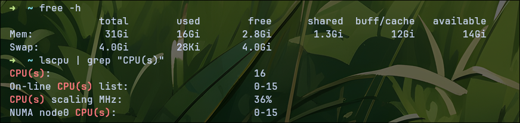

eim Overcommitment von VMs kamen bei mir unterschiedliche Ergebnisse.
Das CPU Overcommitment ging es und ich konnte eine 20 core cpu haben.

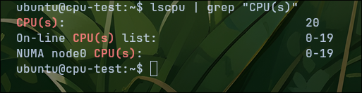

Leider ging dies beim RAM nicht und ich bekam eine fehlermeldung als ich den ram von 32 auf 36 erhöht habe-

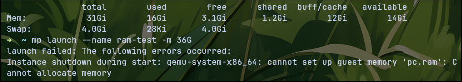

#### Erklärung

Die CPU lässt sich overcommiten, da es einfach nur threads sind
und diese von Arch in keinem weg blockiert werden.

Beim Ram hingegen wird per default swap blokiert wodurch man nicht overcommiten kann. In der file `/proc/sys/vm/overcommit_memory` wird eingestellt ob swap erlaubt ist. Dies ist bei default auf 0, also nicht erlaubt, und man müsste als root die file bearbeiten.

### Aufgabe C

#### Unteraufgabe 1

Ich konnte die vm mit dem Skript [claud-init-basis.yaml](./cloud-init-basis.yaml) instalieren und die programme sind alle erschienen.

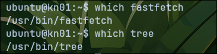

Auch die begruessung.txt file wurde erfolgreich erstellt.

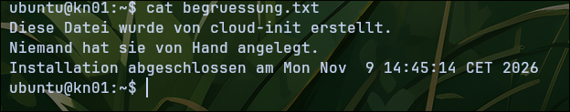

Auch das log sah fehlerfrei aus.

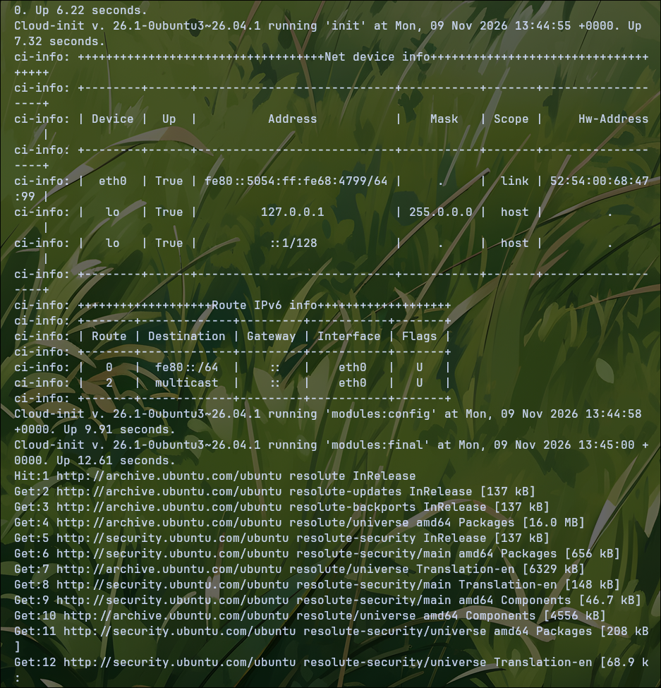

#### Unteraufgabe 2

Ich konnte die Datei [cloud-init-kn01.yaml](./cloud-init-kn01.yaml) erfolgreich anpassen und auch die überprüfung ging gut.

Der benutzter "Diego" wurde erfolgreich erstellt und hat sudo rechte sowie
bash als default shell

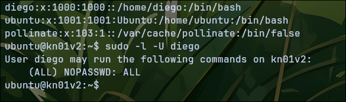

Ich konnte den text editor vim hinzufügen.

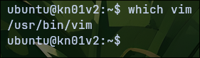

Die file info.txt mit infos über den user "Diego" wurde auch erstellt
und hat auch die ergebnisse des ausgeführten command drinnen.

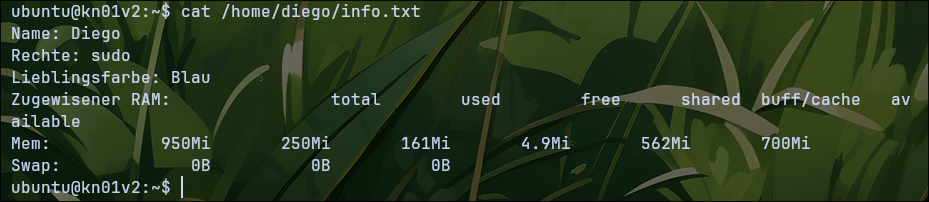

### Aufgabe D

Das neu erstellen von der VM hat mir ganze 5 Minuten und 9 Sekunden gekostet.

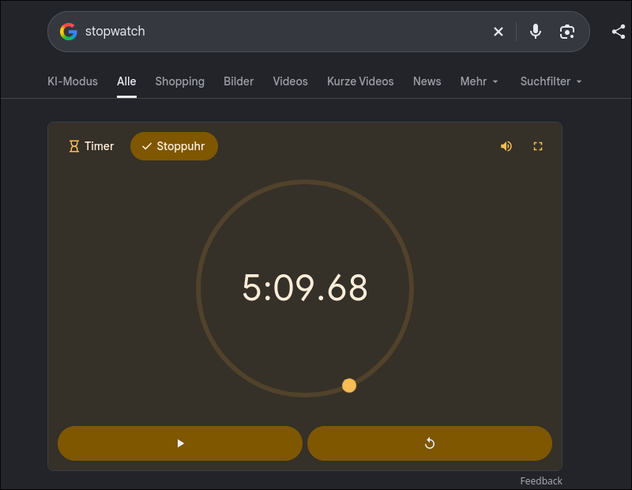

Diese Zeit ist noch ohne die Creation von der VM und ich musste ein paar mal nachschauen wie ein paar befehle gingen. Bei der Automatischen Kreation hatte ich nur 35 Sekunden, was sogar mit VM Erstellung ist.

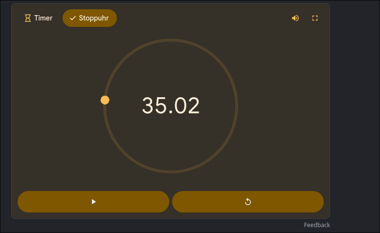

#### Zusammenfassung

Die manuelle Kreation ist viel anstrengender als die automatisierte, da man alle commands immer wieder eingeben muss, bei Fehlern muss man diese debuggen und es wiederholt sich immer. Die automatisierte Erstellung ist hingegen viel schneller, da sie direkt beim erstellen alle Sachen ausführt. Der Zeitverbrauch ist auch sehr unterschiedlich bei den zwei arten. Beim manuellen wird die grösste zeit bei der ausführung der commands sein, was man immer wieder neu machen muss. In der automatisierten Variante verbringt man ein mal 5-10 Minuten ein script in yaml zu schreiben, welches dann unentlich oft wiederholen kann, wodurch es sich viel mehr lohnt wenn man 10+ VMs aufsetzten muss. Leider wird es schwierig wenn es eine Dynamische Aufgabe wird, bei welcher es je nach Hardware immer anderst ist.

## Lernziele

- [x] Ich habe ein Abgabe-Repository mit sauberer Struktur eingerichtet und weiss, dass Code immer als Datei abgegeben wird.
- [x] Ich habe Multipass installiert, eine erste VM gestartet und wieder gelöscht – und weiss, wo ich bei Problemen nachschauen kann (A3).
- [x] Ich kann erklären, was ein Hypervisor ist, und kenne den Unterschied zwischen Typ 1 und Typ 2.
- [x] Ich kann Overcommitment mit den Konzepten Zeitscheiben (CPU) und Swap (RAM) erklären und habe es experimentell überprüft.
- [x] Ich kenne die YAML-Grundelemente (Key-Value, Listen, Verschachtelung) und die typischen Syntax-Fallen.
- [x] Ich kenne die cloud-init-Blöcke `users`, `package_update`, `packages`, `write_files`, `runcmd` und kann jede Zeile meiner Konfiguration erklären.
- [x] Ich weiss, wo das cloud-init-Log liegt, und kann damit Fehler finden.
- [x] Ich kann begründen, warum automatisierte Installation der manuellen überlegen ist – und kenne die Einschränkung, dass cloud-init nur beim ersten Boot läuft.
