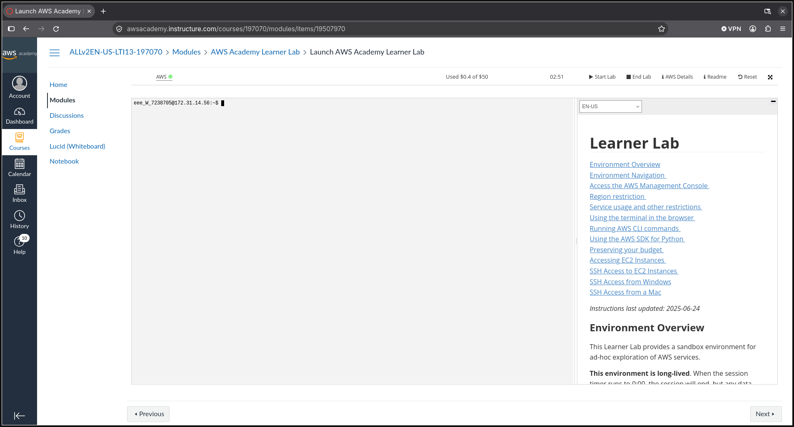
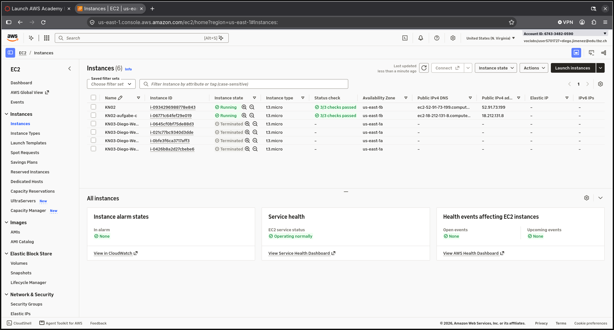
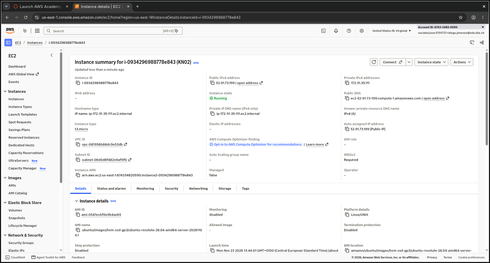
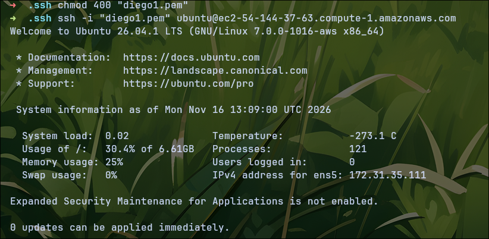
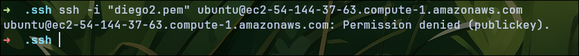
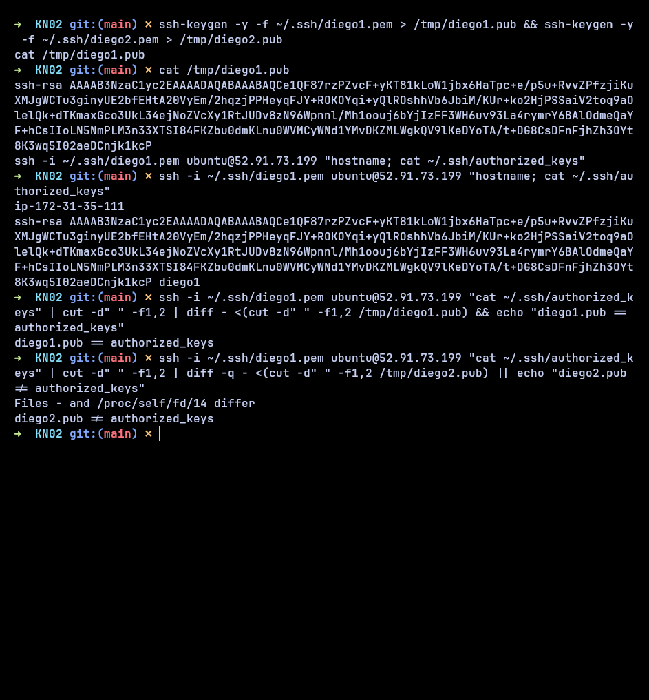
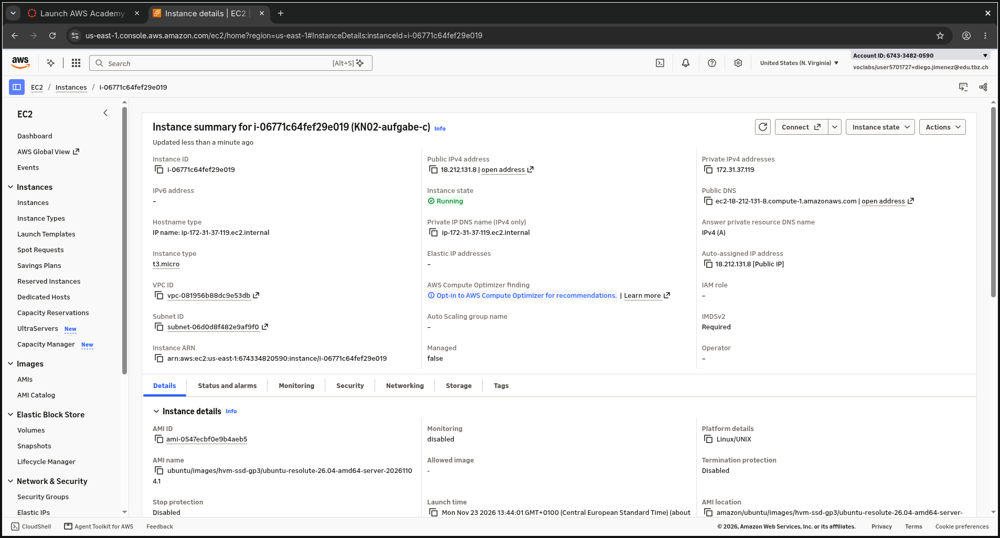
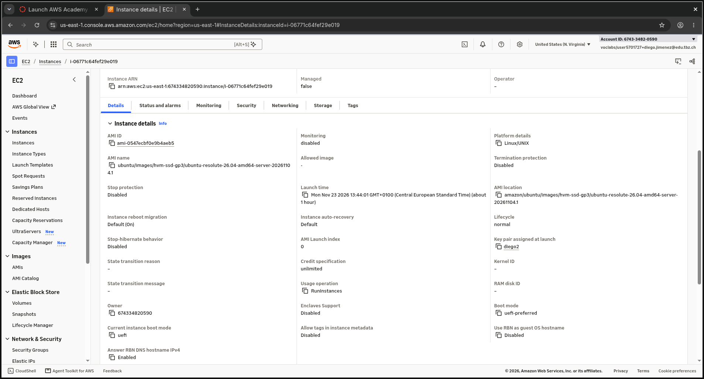
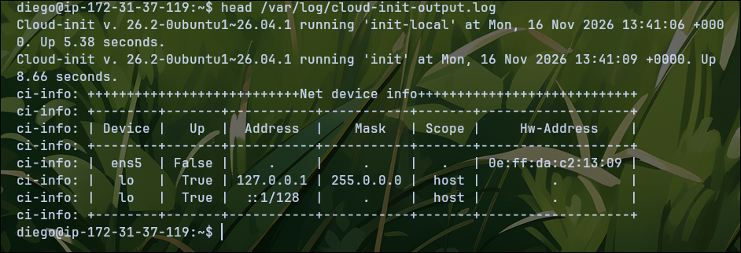

# KN02: Cloud-Onboarding & SSH

## Übersicht

| Datei | Zweck |
| --- | --- |
| [cloud-init-kn01.yaml](./cloud-init-kn01.yaml) | C1: meine cloud-init-Datei aus KN01, erweitert um meinen öffentlichen Schlüssel (AWS-Version) |
| [cloud-init-template.yaml](./cloud-init-template.yaml) | C3: mein persönliches Template für alle folgenden KNs |

| Instanz | Teil | Key Pair (GUI) | Öffentliche IP | Benutzer / Schlüssel |
| --- | --- | --- | --- | --- |
| `KN02` | B | `diego1` | `52.91.73.199` | `ubuntu` mit `diego1` |
| `KN02-aufgabe-c` | C | `diego2` | `18.212.131.8` | `ubuntu` mit `diego2`, `diego` mit `diego1` (aus cloud-init) |

Beide Instanzen: Ubuntu Server 26.04, Typ `t3.micro`, Region `us-east-1`.

Die öffentlichen IPs in der Tabelle sind vom 23.11.2026. Am Ende jeder Lab-Session werden die Instanzen gestoppt, und beim nächsten Start vergibt AWS eine **neue öffentliche IP**. Darum zeigen die SSH-Screenshots vom 16.11.2026 andere Adressen (z. B. `ec2-54-144-37-63...`). Die private IP bleibt gleich: `KN02` hat immer `172.31.35.111`, `KN02-aufgabe-c` immer `172.31.37.119` (sichtbar im Prompt `ip-172-31-...`).

## A) Learner Lab einrichten

Ich habe den Kurs «AWS Academy Learner Lab» geöffnet und das Lab gestartet. Der grüne Kreis neben «AWS» zeigt, dass das Lab läuft, daneben sieht man das verbrauchte Budget:

Über den Link «AWS» bin ich in die AWS Management Console gekommen und konnte EC2 öffnen. Rechts oben steht mein Benutzername (`voclabs/user5701727=diego.jimenez@edu.tbz.ch`):

## B) SSH-Schlüssel verstehen: das Zwei-Schlüssel-Experiment

### B1) Instanz mit Schlüsselpaar erstellen

Ich habe im GUI zwei Schlüsselpaare `diego1` und `diego2` erstellt und die `.pem`-Dateien nach `~/.ssh/` gelegt (`chmod 400`, sonst verweigert SSH den Schlüssel). Danach habe ich die Instanz `KN02` mit dem Key Pair **`diego1`** erstellt.

### B2) Das Experiment

Instanz-Details von `KN02` (`i-0934296988778e843`): oben die öffentliche IP `52.91.73.199`, weiter unten im Tab *Details* das verwendete Key Pair (`Key pair assigned at launch: diego1`):

Eigenschaften der Instanz:

| Was | Wert |
| --- | --- |
| Disk-Grösse | 6.61 GiB |
| Betriebssystem | Ubuntu 26.04.1 LTS (Resolute Raccoon) |
| RAM | 908.63 MiB |
| CPU-Modell | Intel(R) Xeon(R) Platinum 8259CL |
| Anzahl CPUs | 2 |

Mit dem **ersten** Schlüssel (`diego1`) konnte ich mich verbinden:

Mit dem **zweiten** Schlüssel (`diego2`) wurde die Verbindung abgelehnt (`Permission denied (publickey)`):

**Vergleich Public Key ↔ `authorized_keys`:** Mit `ssh-keygen -y -f ~/.ssh/diego1.pem` habe ich aus dem privaten Schlüssel den öffentlichen Schlüssel berechnet (das geht, weil der öffentliche Schlüssel mathematisch aus dem privaten folgt, aber nicht umgekehrt). Danach habe ich ihn mit `~/.ssh/authorized_keys` des Benutzers `ubuntu` auf dem Server verglichen:

Der öffentliche Schlüssel von `diego1` steht genau so in `authorized_keys`, der von `diego2` nicht. Er liegt dort, weil AWS beim Erstellen der Instanz den öffentlichen Teil des im GUI gewählten Key Pairs (`diego1`) in die Instanz übergibt und cloud-init ihn beim ersten Boot in `/home/ubuntu/.ssh/authorized_keys` schreibt. Beim Login prüft der Server, ob ich den passenden privaten Schlüssel besitze. Darum funktioniert nur `diego1.pem`.

## C) Erste Instanz mit cloud-init & Ihr Template

### C1) cloud-init mit SSH-Schlüssel erweitern & Instanz erstellen

Ich habe meine `cloud-init-kn01.yaml` aus KN01 im `users`-Block um meinen öffentlichen Schlüssel `diego1` erweitert ([cloud-init-kn01.yaml](./cloud-init-kn01.yaml)). Die Instanz `KN02-aufgabe-c` habe ich mit dem Key Pair **`diego2`** erstellt und die Datei ins Feld **User data** kopiert.

Instanz-Details von `KN02-aufgabe-c` (`i-06771c64fef29e019`): öffentliche IP `18.212.131.8` bzw. DNS `ec2-18-212-131-8.compute-1.amazonaws.com`, und weiter unten **Key pair assigned at launch** = `diego2`:

Login als Standardbenutzer `ubuntu` mit dem **zweiten** Schlüssel (`diego2`, aus dem GUI): funktioniert.

Login als mein cloud-init-Benutzer `diego` mit dem **ersten** Schlüssel (`diego1`, aus cloud-init): funktioniert.

Login als `diego` mit dem **zweiten** Schlüssel: wird abgelehnt.

Die beiden Mechanismen beeinflussen sich also nicht: Das Key Pair aus dem GUI gilt nur für den Standardbenutzer `ubuntu`, die Schlüssel aus `ssh_authorized_keys` im cloud-init nur für meinen Benutzer `diego`.

### C2) Nachweise in der laufenden Instanz

Eingeloggt als `diego` mit `diego1` habe ich meine KN01-Erweiterungen geprüft: Die Datei `info.txt` aus `write_files` ist vorhanden, und das Paket `vim` ist installiert (`/usr/bin/vim`):

Auszug aus dem cloud-init-Log mit dem Befehl `head /var/log/cloud-init-output.log` (derselbe Pfad wie lokal in KN01):

### C3) Mein persönliches Template

Datei: [cloud-init-template.yaml](./cloud-init-template.yaml). Gegenüber C1 enthält das Template drei zusätzliche Konfigurationen:

1. **Schlüssel der Lehrperson:** Unter `ssh_authorized_keys` steht neben meinem Schlüssel `diego1` auch der öffentliche Schlüssel der Lehrperson. Das Template enthält also zwei öffentliche Schlüssel, und die Lehrperson kann sich auf meine zukünftigen Instanzen als `diego` einloggen.
2. **Härtung:** `ssh_pwauth: false` schaltet den SSH-Login mit Passwort aus, es geht nur noch mit Schlüssel (kein Passwort-Erraten möglich). `disable_root: true` verbietet den direkten SSH-Login als `root`. Admin-Befehle laufen nur über einen normalen Benutzer mit `sudo`.
3. **`package_update: true`:** Beim ersten Boot wird der Paketindex aktualisiert (`apt-get update`), damit die Pakete unter `packages` in der aktuellen Version gefunden und installiert werden können.

**Reflexion:** Meine cloud-init-Datei aus KN01 lief lokal in Multipass und, um einen Schlüssel erweitert, unverändert in AWS. Die Konfiguration ist also portabel: Sie beschreibt nur, wie das Betriebssystem eingerichtet werden soll, und jede Plattform mit cloud-init (Multipass, AWS, Azure, …) führt sie beim ersten Boot gleich aus. Eine Grenze ist, dass sich Paketnamen oder Pfade je nach Image unterscheiden können, z. B. auf einer anderen Linux-Distribution. Mit GUI-Klicks ist das prinzipiell unmöglich, weil die Klicks nirgends gespeichert sind: Man müsste sie auf jeder Plattform und für jede VM von Hand wiederholen, und die Oberflächen von Multipass und AWS sind völlig verschieden. Eine Datei dagegen kann ich versionieren, kopieren und beliebig oft wiederverwenden.

## Lernziele

- [x] Ich komme mit dem AWS Academy Learner Lab zurecht: Umgebung starten/stoppen, Budget einsehen, und ich weiss, was nach 4 Stunden passiert.
- [x] Ich kann eine EC2-Instanz erstellen und die Einstellungen zu Speicher, RAM und CPU bestimmen.
- [x] Ich kann erklären, wie die Public/Private-Key-Authentifizierung funktioniert und wo (Gerät und Verzeichnis) welcher Schlüssel liegen muss.
- [x] Ich kann den öffentlichen Schlüssel aus dem privaten extrahieren und den ssh-Befehl mit seinen Parametern anwenden.
- [x] Ich kann SSH-Schlüssel per cloud-init verteilen und habe mein persönliches cloud-init-Template erstellt (inkl. Schlüssel der Lehrperson).
- [x] Ich kann begründen, warum dieselbe cloud-init-Datei lokal (Multipass) und in AWS funktioniert – und was das über Infrastructure as Code aussagt.
