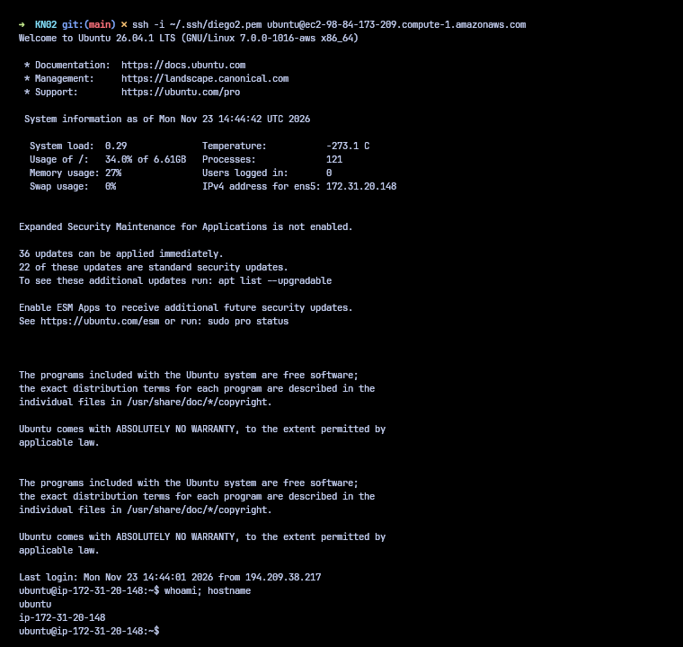
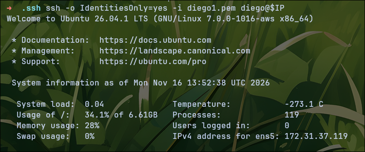
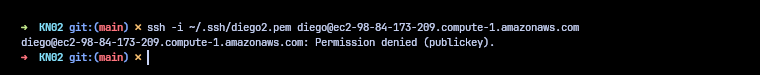
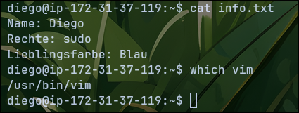

# KN02

## Dokumentation

### A) Learner Lab einrichten

- Erstellung ging und ich konnte auf EC2 zugreifen

### B) SSH-Schlüssel verstehen: das Zwei-Schlüssel-Experiment

#### B1) Instanz mit Schlüsselpaar erstellen

- Creation war erfolgreich

#### B2) Das Experiment

Ich konnte mich mit dem ersten key par verbinden und hatte zugriff auf die VM.

Beim zweiten Schlüsselpaar ging dies nicht und ich wurde nicht verbunden.

Dies sind die Eigenschaften von der VM:

| Was            | wert                                    |
| -------------- | --------------------------------------- |
| Disk Grösse    | 6.61GiB                                 |
| Betriebssystem | Ubuntu 26.04.1 LTS (Resolute Raccoon) 4 |
| RAM            | 908.63 MiB                              |
| CPU            | Intel(R) Xeon(R) Platinum 8259CL (2) z  |
| CPU            | 2                                       |

### C) Erste Instanz mit cloud-init & Ihr Template

#### C1) cloud-init mit SSH-Schlüssel erweitern & Instanz erstellen

Ich konnte die Instanz erstellen und meine [cloud-init-KN02](./cloud-init-kn02.yaml) file als zusätzlicher benutzter hinzufügen.

Ich konnte mich als `ubuntu` mit dem ssh Schlüssel `diego2` einloggen

Auch der diego benutzter mit dem key `diego1` hat funktioniert

Und wie erwartet konnte ich mich mit dem `diego2` ssh key nicht ind diego einloggen

#### C2) Nachweise in der laufenden Instanz

Ich konnte meine packages und die bearbeiteten files anschauen

Auch die logs waren intakt und ich habe mit head die logs angeschaut

#### C3) Ihr persönliches Template

Ich habe die [cloud-init-template-diego.yaml](./cloud-init-template-diego.yaml) file erstellt und habe die ssh keys hinzugefügt.

Reflexion:

Ich habe gar kein multipass gebraucht was bedeutet ich kann cloud init Dateien ausserhalb von multipass benutzten und sie sind sehr wahrscheinlich universel. Dies ist gut, da ich jetzt für alle zukünftigen container diese file auch benutzten kann. Ich vermute das dies auch distro übergreifend funktioniert, aber habe keine Ahnung ob dies kaput geht wenn ein gewisses package auf z. B. Windows nicht gibt.

## Lernziele

- [x] Ich komme mit dem AWS Academy Learner Lab zurecht: Umgebung starten/stoppen, Budget einsehen, und ich weiss, was nach 4 Stunden passiert.
- [x] Ich kann eine EC2-Instanz erstellen und die Einstellungen zu Speicher, RAM und CPU bestimmen.
- [x] Ich kann erklären, wie die Public/Private-Key-Authentifizierung funktioniert und wo (Gerät und Verzeichnis) welcher Schlüssel liegen muss.
- [x] Ich kann den öffentlichen Schlüssel aus dem privaten extrahieren und den ssh-Befehl mit seinen Parametern anwenden.
- [x] Ich kann SSH-Schlüssel per cloud-init verteilen und habe mein persönliches cloud-init-Template erstellt (inkl. Schlüssel der Lehrperson).
- [x] Ich kann begründen, warum dieselbe cloud-init-Datei lokal (Multipass) und in AWS funktioniert – und was das über Infrastructure as Code aussagt.
