# KN03: OpenTofu I – Infrastruktur als Code

<!--toc:start-->

- [KN03: OpenTofu I – Infrastruktur als Code](#kn03-opentofu-i--infrastruktur-als-code)
  - [Übersicht der Dateien](#übersicht-der-dateien)
  - [Umgebung (Netzwerkplan)](#umgebung-netzwerkplan)
  - [A) Setup & der Zyklus](#a-setup--der-zyklus)
  - [B) Instanz + Security Group + cloud-init als Code](#b-instanz--security-group--cloud-init-als-code)
  - [C) Zerstören ohne Angst: Reproduzierbarkeit & State](#c-zerstören-ohne-angst-reproduzierbarkeit--state)
  - [D) KI-Review: fremden Code beurteilen](#d-ki-review-fremden-code-beurteilen)
  - [Lernziele](#lernziele)

<!--toc:end-->

## Übersicht der Dateien

| Datei | Zweck |
| --- | --- |
| [.gitignore](./.gitignore) | schliesst State (`terraform.tfstate*`), `.terraform/` und `*.tfvars` vom Git aus |
| [A2/main.tf](./A2/main.tf) | Teil A2: nur eine Security Group `KN03-SG-Diego` |
| [providers.tf](./providers.tf) | Teil B: `terraform`- und `provider`-Block (Region `us-east-1`) |
| [main.tf](./main.tf) | Teil B: Security Group + EC2-Instanz mit cloud-init |
| [outputs.tf](./outputs.tf) | Teil B: Output der öffentlichen IP |
| [cloud-init-template.yaml](./cloud-init-template.yaml) | mein cloud-init-Template aus KN02, als `user_data` übergeben |
| [D/review-config.tf](./D/review-config.tf) | Teil D: die KI-generierte Originaldatei (nicht ausgeführt) |
| [D/review-config-fixed.tf](./D/review-config-fixed.tf) | Teil D: meine korrigierte Version |
| [D/cloud-init-db.yaml](./D/cloud-init-db.yaml) | Teil D: cloud-init für den korrigierten DB-Server |

Alle Befehle in Teil A2 laufen im Ordner `KN03/A2/`, alle Befehle in Teil B und C im Ordner `KN03/`. Ein OpenTofu-Projekt besteht immer aus **allen** `.tf`-Dateien in einem Ordner. Darum liegen A2 und D in eigenen Unterordnern, sonst würden sie zusammen mit Teil B angewendet.

## Umgebung (Netzwerkplan)

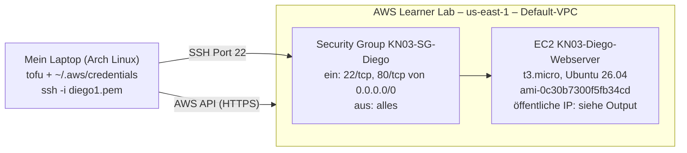

| Eigenschaft | Wert |
| --- | --- |
| Region | `us-east-1` |
| AMI | `ami-0c30b7300f5fb34cd` (Ubuntu Server 26.04 LTS, amd64, Build 20261120) |
| Instanztyp | `t3.micro` (2 vCPU, 1 GiB RAM) |
| Security Group | `KN03-SG-Diego`: eingehend 22/tcp + 80/tcp, ausgehend alles |
| Benutzer | `ubuntu` (Standard), `diego` (sudo, Schlüssel `diego1`, Schlüssel der Lehrperson) |
| Öffentliche IP | wird von AWS bei jeder neuen Instanz neu vergeben, darum als Output. Während KN03: `107.20.101.91` (B1), `3.89.119.214` (B2), `18.234.110.229` (C1), `34.224.174.10` (C2) |

## A) Setup & der Zyklus

### A1) Werkzeuge einrichten

Ich habe OpenTofu auf Arch Linux mit `sudo pacman -S opentofu` installiert und die Installation mit `tofu -version` geprüft.

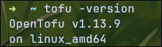

Danach habe ich das Learner Lab gestartet und die Credentials-Routine ausgeführt: unter *AWS Details → AWS CLI → Show* den ganzen Block (`aws_access_key_id`, `aws_secret_access_key`, `aws_session_token`) kopieren und in `~/.aws/credentials` einfügen. Die Datei liegt in meinem Home-Verzeichnis, also ausserhalb des Repos. Die `.gitignore` in `KN03/` schliesst den State und `.terraform/` aus.

### A2) Der Zyklus mit einer einzigen Ressource

Konfiguration: [A2/main.tf](./A2/main.tf)

1. **`tofu init`** hat den AWS-Provider (`hashicorp/aws` 5.x) aus der Registry in den Ordner `.terraform/` heruntergeladen und die Datei `.terraform.lock.hcl` mit der genauen Version und den Prüfsummen erstellt.
2. **`tofu plan`** zeigt `Plan: 1 to add, 0 to change, 0 to destroy`. Die Security Group ist mit `+` markiert (wird erstellt). Werte wie `id` oder `arn` stehen auf `(known after apply)`, weil AWS sie erst beim Erstellen vergibt.

   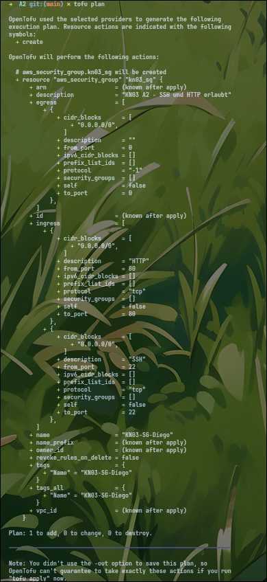

3. **`tofu apply`** hat die Gruppe nach meiner Bestätigung mit `yes` erstellt (`Creation complete after 4s [id=sg-0fdccb9f7aee2f53d]`). Im AWS-GUI (EC2 → Security Groups) ist sie mit dem Namen `KN03-SG-Diego` und den Regeln für Port 22 und 80 sichtbar:

   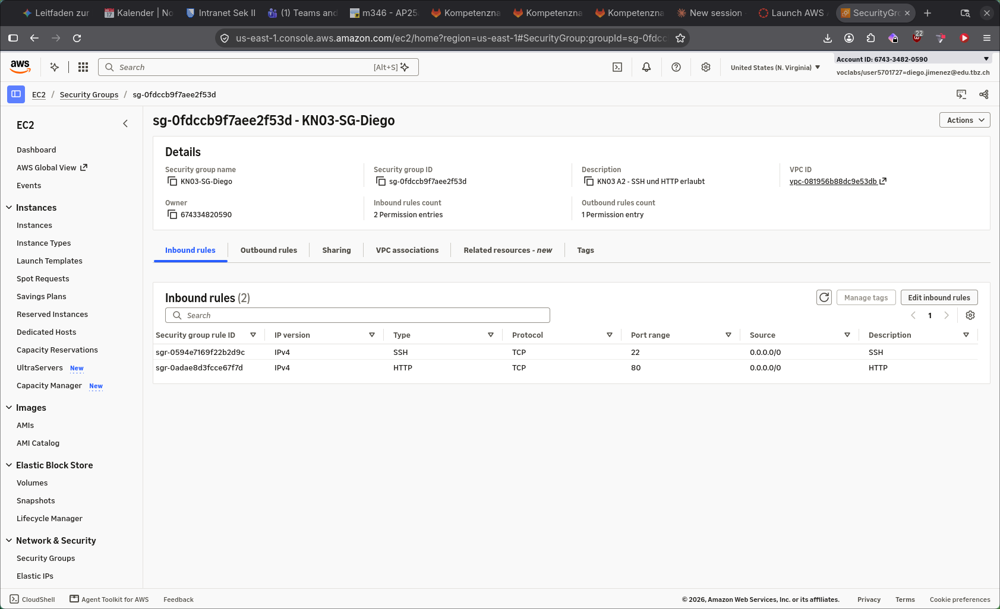

4. **`tofu plan` direkt nach dem `apply`** meldet `No changes. Your infrastructure matches the configuration.` (siehe Antwort unten).
5. **Beschreibung eines Ports geändert** (`"SSH"` → `"SSH Zugriff"`): Der Plan zeigt `~ update in-place` für `aws_security_group.kn03_sg`. Innerhalb von `ingress` ist die alte Regel mit `-` und die neue mit `+` markiert, weil die Regeln als Menge (Set) gespeichert werden. Am Schluss steht `Plan: 0 to add, 1 to change, 0 to destroy`.

   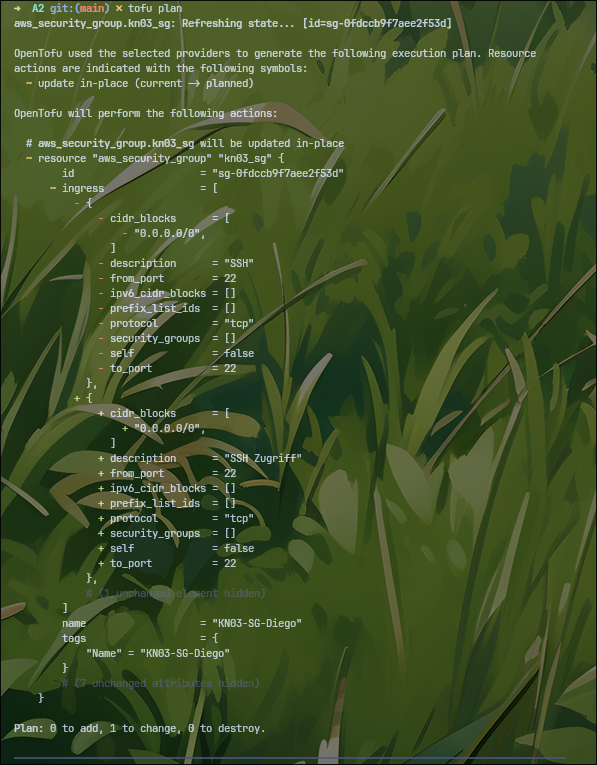

6. **`tofu destroy`** hat die Gruppe wieder gelöscht (`Destroy complete! Resources: 1 destroyed.`). Im GUI ist sie nicht mehr vorhanden.

#### Antwort: Was zeigt `tofu plan` direkt nach `apply`, und warum ist das der Kernunterschied zu einem Bash-Skript?

`tofu plan` zeigt nach einem erfolgreichen `apply` **«No changes»**, weil der gewünschte Zustand (Code) und der tatsächliche Zustand in AWS bereits übereinstimmen. OpenTofu ist **deklarativ**: Ich beschreibe *was* existieren soll, und OpenTofu berechnet selbst die Differenz zum Ist-Zustand. Deshalb ist es **idempotent**: Ich kann `apply` beliebig oft ausführen, und es passiert nur etwas, wenn wirklich etwas fehlt oder anders ist. Ein Bash-Skript mit CLI-Befehlen (z. B. `aws ec2 create-security-group ...`) ist **imperativ**: Es führt Schritte aus, ohne den Ist-Zustand zu kennen. Beim zweiten Ausführen würde es dieselbe Gruppe nochmals erstellen wollen und mit «already exists» abbrechen (oder Duplikate erzeugen), und Änderungen oder Löschungen müsste ich selbst programmieren.

## B) Instanz + Security Group + cloud-init als Code

### B1) Die Konfiguration

Dateien: [providers.tf](./providers.tf), [main.tf](./main.tf), [outputs.tf](./outputs.tf), [cloud-init-template.yaml](./cloud-init-template.yaml). Jede Zeile ist in den Dateien kommentiert.

- **Security Group** `aws_security_group.web_sg`: eingehend 22 und 80, ausgehend alles.
- **Instanz** `aws_instance.web`: AMI `ami-0c30b7300f5fb34cd` (Ubuntu 26.04 für `us-east-1`, im Ubuntu Cloud Image Locator bzw. EC2 AMI Catalog nachgeschlagen), Typ `t3.micro`.
- **cloud-init**: `user_data = file("cloud-init-template.yaml")`. Es gibt **kein** `key_name`, weil die SSH-Schlüssel über `ssh_authorized_keys` aus dem cloud-init kommen.
- **Referenz**: `vpc_security_group_ids = [aws_security_group.web_sg.id]`, keine hartcodierte `sg-...`-ID.
- **Output**: `public_ip = aws_instance.web.public_ip`.

Gegenüber KN02 habe ich das cloud-init-Template leicht angepasst. Die Kommentare sind jetzt fachlich korrekt (`package_update` aktualisiert nur den Paketindex, `|` leitet einen mehrzeiligen Textblock ein). Ausserdem schreibe ich `info.txt` mit `defer: true` erst, wenn der Benutzer `diego` existiert.

`tofu init`, danach `tofu apply`. Der Plan zeigt die Instanz mit dem AMI, `t3.micro`, dem Name-Tag und `user_data_replace_on_change = true`:

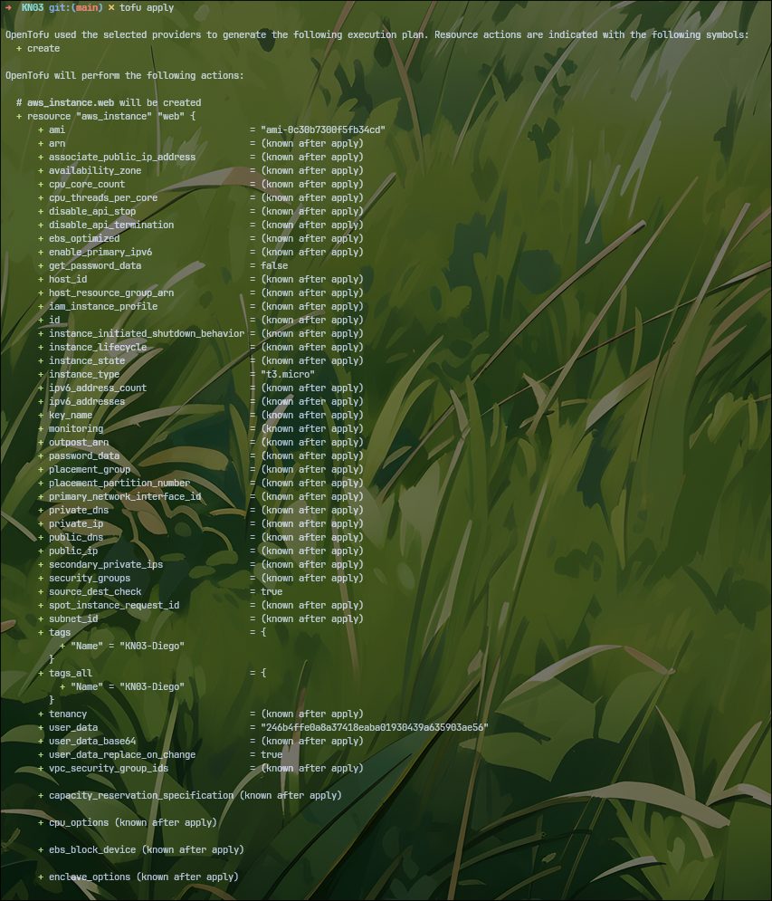

Nach der Bestätigung mit `yes`: `Apply complete! Resources: 2 added, 0 changed, 0 destroyed.` und der Output `public_ip = "107.20.101.91"`. Man sieht auch die Reihenfolge: zuerst `aws_security_group.web_sg: Creation complete ... [id=sg-0f2ced2e8205b5bd0]`, erst danach `aws_instance.web: Creating...`.

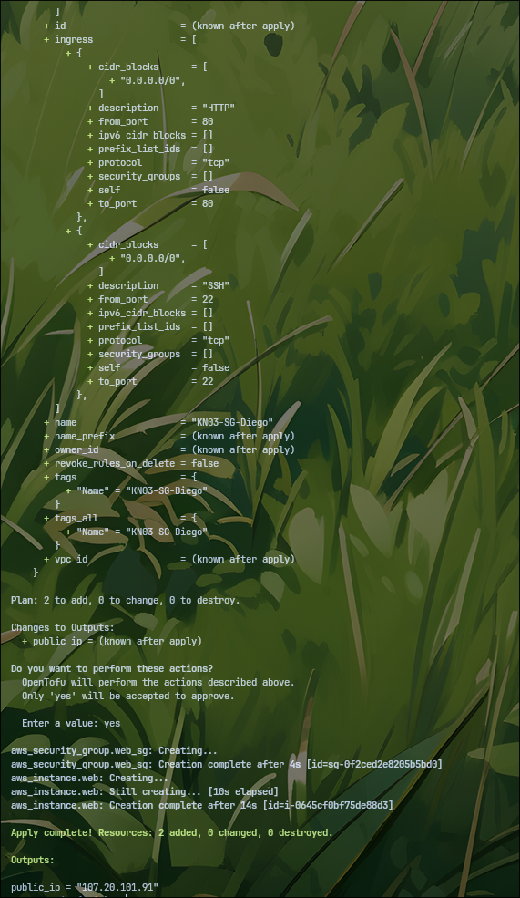

**SSH-Login** als mein cloud-init-Benutzer `diego` mit meinem privaten Schlüssel `diego1.pem` auf die IP aus dem Output (`ssh -i ~/.ssh/diego1.pem diego@107.20.101.91`). Es braucht kein Key Pair aus dem GUI, der Schlüssel kommt aus dem cloud-init:

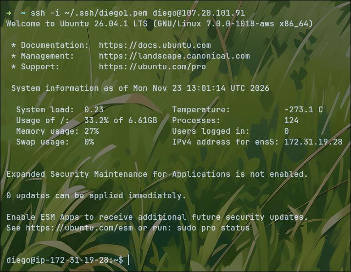

**cloud-init hat gegriffen**: Auf der Instanz zeigen folgende Befehle, dass meine Konfiguration beim ersten Boot ausgeführt wurde:

- `cloud-init status` → `status: done`
- `cat ~/info.txt ~/cloud-init-fertig.txt` → `info.txt` aus `write_files` und die Zeile `Installation abgeschlossen am Mon Nov 23 12:58:41 UTC 2026` aus `runcmd` (das Datum wurde zur Laufzeit ausgewertet)
- `tree --version` und `fastfetch` → die Pakete aus `packages` sind installiert, fastfetch zeigt Ubuntu 26.04.1 LTS auf `t3.micro`
- `sudo grep -E "Setting up (tree|fastfetch)|finished at" /var/log/cloud-init-output.log` → im Log stehen die Paketinstallationen und `Cloud-init v. 26.2 ... finished at Mon, 23 Nov 2026 12:58:41`

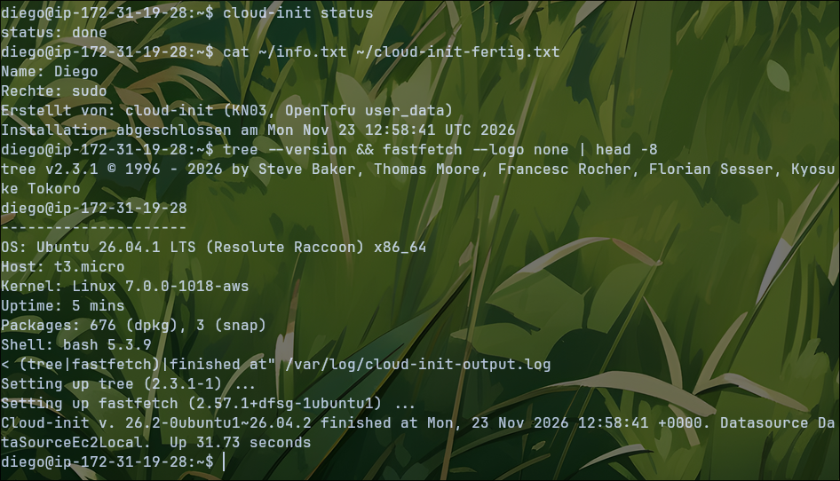

#### Erklärung: Wie «weiss» OpenTofu, dass die Security Group vor der Instanz erstellt werden muss?

Die Instanz verwendet in `vpc_security_group_ids` den Ausdruck `aws_security_group.web_sg.id`, also ein Attribut einer anderen Ressource. OpenTofu liest aus solchen Referenzen eine **implizite Abhängigkeit** heraus und baut daraus einen **Abhängigkeitsgraphen**: Die Instanz kann erst erstellt werden, wenn die ID der Security Group bekannt ist. Deshalb wird zuerst die Security Group erstellt und danach die Instanz. Beim `destroy` gilt die umgekehrte Reihenfolge. Ressourcen ohne gegenseitige Referenz würden parallel erstellt.

### B2) Änderungen beobachten: ändern vs. ersetzen

**Änderung 1: Name-Tag der Instanz** (`KN03-Diego` → `KN03-Diego-Webserver`). Der Plan zeigt `~ update in-place` mit `~ tags = { ~ "Name" = "KN03-Diego" -> "KN03-Diego-Webserver" }` und `Plan: 0 to add, 1 to change, 0 to destroy`. Die Instanz-ID `i-0645cf0bf75de88d3` und die öffentliche IP bleiben gleich.

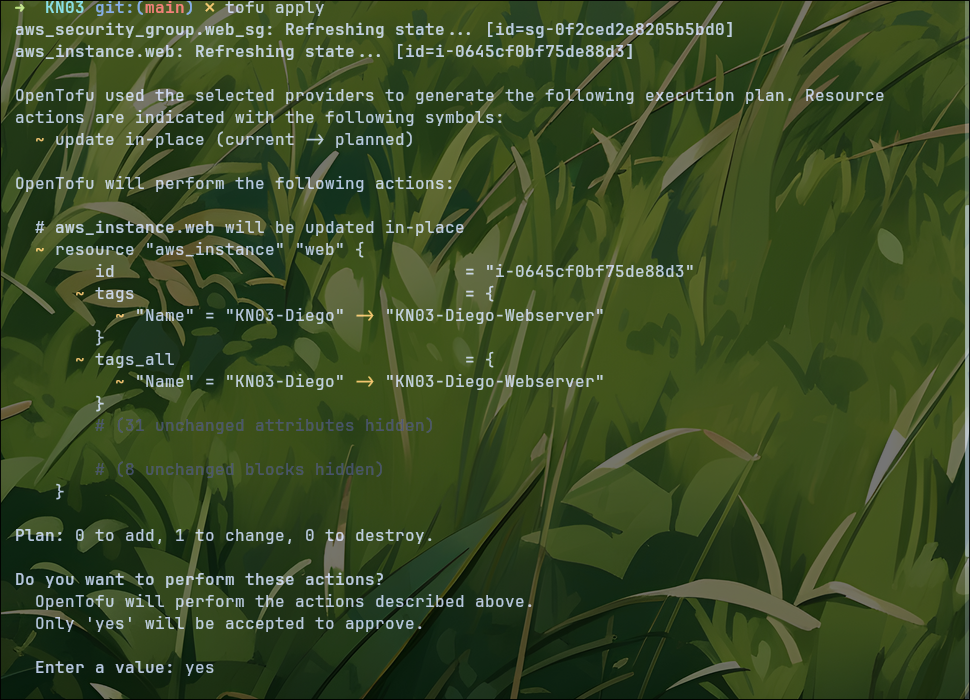

**Änderung 2: zusätzliches Paket `htop` im cloud-init.** Der Plan zeigt `-/+ destroy and then create replacement` mit `~ user_data = "..." -> "..." # forces replacement` und `Plan: 1 to add, 0 to change, 1 to destroy`. Nach dem `apply` hat die Instanz eine neue ID (`i-0bfe3f6ca3717aff3`) und eine neue IP (`3.89.119.214`). Per SSH habe ich geprüft, dass `cloud-init status` wieder `done` meldet und `htop` installiert ist (`/usr/bin/htop`). Die neue Konfiguration wurde also wirklich angewendet.

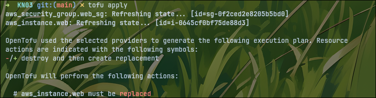

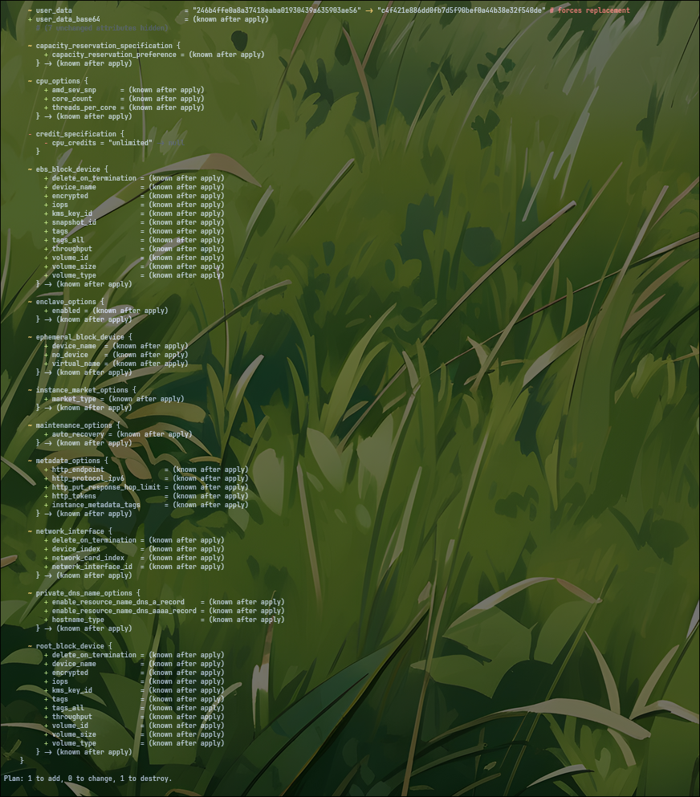

#### Erklärung: Warum `destroy and then create replacement` bei cloud-init, aber `update in-place` beim Tag?

Ein Tag ist nur eine Metadaten-Angabe, die AWS über die API an einer laufenden Instanz ändern kann (`CreateTags`). Darum kann OpenTofu die bestehende Instanz direkt anpassen (`~`). Die User Data dagegen wird von cloud-init **nur beim ersten Boot** ausgewertet. Eine geänderte cloud-init-Datei hätte auf einer bestehenden Instanz also keine Wirkung, weil das Paket `htop` nie installiert würde. Damit der Code und die echte Instanz übereinstimmen, muss eine **neue** Instanz gebaut werden, die mit der neuen User Data zum ersten Mal bootet. Das bedeutet `-/+`, also zuerst die alte zerstören und dann eine neue erstellen. Wichtig: Der AWS-Provider würde ohne die Option `user_data_replace_on_change = true` die User Data nur durch Stoppen/Starten in-place aktualisieren. Ich habe die Option bewusst gesetzt, damit die Änderung tatsächlich wirkt. Die Konsequenz ist, dass alle Daten auf der alten Instanz verloren gehen und sich die IP ändert. Das ist der Grund, warum man Konfiguration in Code und nicht von Hand auf der Instanz pflegt.

## C) Zerstören ohne Angst: Reproduzierbarkeit & State

### C1) Alles weg, alles wieder da

Mit `tofu destroy` habe ich die komplette Umgebung gelöscht (`Destroy complete! Resources: 2 destroyed.`). OpenTofu hat dabei zuerst die Instanz und danach die Security Group gelöscht, also die umgekehrte Reihenfolge wie beim Erstellen. Im GUI sind beide KN03-Instanzen `Terminated` (die KN02-Instanzen laufen weiter, sie gehören nicht zu diesem Projekt):

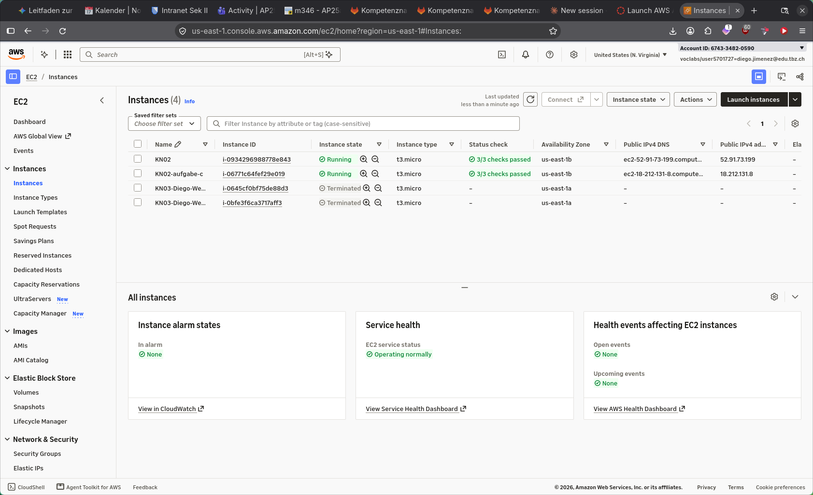

In der Liste der Security Groups gibt es `KN03-SG-Diego` nicht mehr (nur noch `default` und die beiden `launch-wizard`-Gruppen aus KN02):

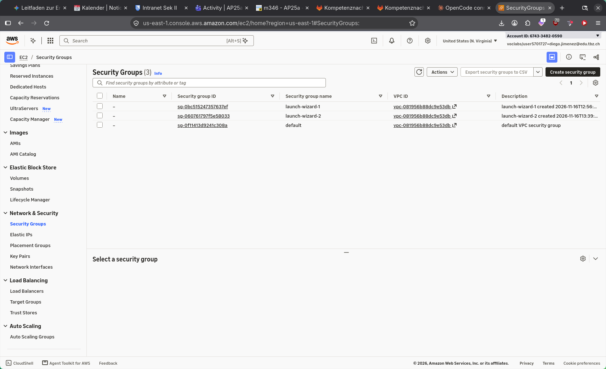

Danach habe ich alles mit **einem** Befehl wiederhergestellt: `time tofu apply -auto-approve`.

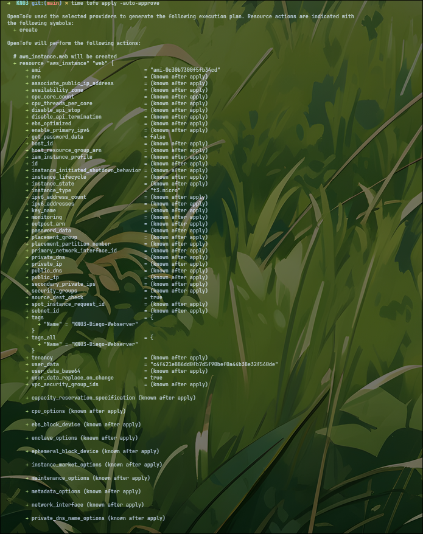

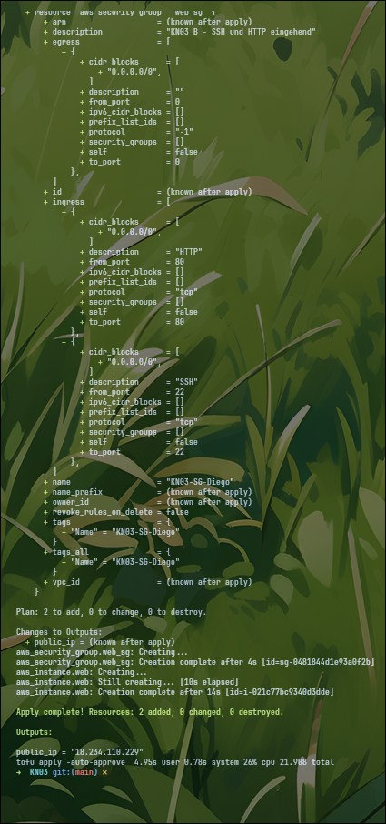

| | Aktive Arbeitszeit | Wartezeit (nicht mitgezählt) |
| --- | --- | --- |
| Wiederherstellung per Code | ca. 5 Sekunden (Befehl `time tofu apply -auto-approve` eintippen + Enter) | 21.9 Sekunden bis `Apply complete` (laut `time`: `21.908 total`), danach ca. 1–2 min, bis cloud-init in der Instanz fertig ist |
| Schätzung GUI wie in KN02 | ca. 8–10 Minuten (Security Group mit zwei Regeln anlegen, Instanz-Assistent: AMI suchen, Typ, Netzwerk, SG auswählen, cloud-init einfügen) | gleiche Boot-/cloud-init-Zeit |

**Interpretation:** Per Code besteht meine aktive Arbeit nur noch aus einem einzigen Befehl. Die restliche Zeit ist reine Wartezeit, in der ich nichts tun muss. Im GUI muss ich jeden Schritt von Hand klicken, und genau dort passieren Fehler, z. B. ein falsches AMI, ein vergessener Port 80, die falsche Security Group oder eine unvollständig kopierte cloud-init-Datei. Ich könnte also **nicht** sicher sein, dass die Umgebung exakt gleich ist. Per Code ist sie es, weil sie jedes Mal aus denselben Dateien entsteht, die zudem versioniert im Git liegen. Der Nachteil ist, dass auch ein Fehler im Code jedes Mal exakt reproduziert wird, und dass Änderungen am cloud-init nur bei neuen Instanzen wirken.

### C2) State verstehen

**Drift-Experiment:** Ich habe die Instanz von Hand im AWS-GUI terminiert und danach `tofu plan` ausgeführt.

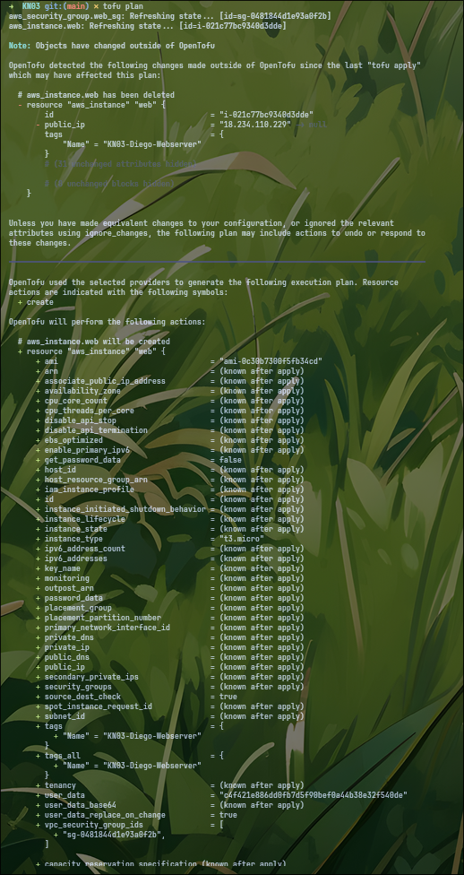

Beim `Refreshing state... [id=i-021c77bc9340d3dde]` fragt OpenTofu die Instanz aus dem State bei AWS ab. Danach meldet es unter *«Note: Objects have changed outside of OpenTofu»*, dass `aws_instance.web` gelöscht wurde (`has been deleted`), und schlägt `+ create` für eine neue Instanz vor (`Plan: 1 to add, 0 to change, 0 to destroy`). Die Security Group ist unverändert und wird nicht angefasst. Danach hat `tofu apply` die Instanz neu erstellt (`Apply complete! Resources: 1 added, 0 changed, 0 destroyed.`, neue IP `34.224.174.10`), und ein weiteres `tofu plan` meldete wieder `No changes`.

**Woher weiss OpenTofu, dass die Instanz fehlt?** Im State (`terraform.tfstate`) ist gespeichert, welche Ressourcen OpenTofu verwaltet, inklusive der Instanz-ID (`i-...`). Vor jedem `plan` macht OpenTofu einen **Refresh**: Es fragt bei der AWS-API für jede ID im State den aktuellen Zustand ab. Weil die Instanz mit dieser ID `terminated` ist, erkennt OpenTofu die Abweichung (**Drift**). Anschliessend vergleicht es den gewünschten Zustand aus dem Code mit dem tatsächlichen und plant, die fehlende Instanz neu zu erstellen.

#### Antwort: Zwei Gründe, warum `terraform.tfstate` nicht ins Git gehört

1. **Sensible Daten im Klartext:** Der State enthält alle Attribute der Ressourcen unverschlüsselt, z. B. IP-Adressen, IDs, die komplette User Data und bei anderen Ressourcen auch Passwörter oder Schlüssel (z. B. von Datenbanken). In einem Repo, besonders in einem öffentlichen, wären diese Daten für alle lesbar und bleiben in der Git-Historie auch nach dem Löschen erhalten.
2. **Konflikte und veralteter Zustand:** Der State ändert sich bei jedem `apply`. Wenn mehrere Personen mit Kopien aus dem Git arbeiten, hat jede Person einen anderen, veralteten State. Gleichzeitige `apply`s können sich überschreiben (kein Locking), was zu doppelten oder verwaisten Ressourcen führt. Im Team gehört der State deshalb in ein Remote-Backend mit Locking (z. B. S3 + Lock). Das Locking habe ich selbst gesehen: Während mein `tofu apply` in B2 noch auf `yes` wartete, brach ein zweites `tofu plan` mit `Error acquiring the state lock` ab. Lokal funktioniert das nur, weil beide Befehle auf derselben Datei liefen. Mit Kopien im Git gäbe es diesen Schutz nicht.

Wenn der State lokal verloren geht, weiss OpenTofu nicht mehr, welche Ressourcen ihm gehören. Ein `apply` würde alles doppelt erstellen. Darum darf man in diesem Fall nicht blind weitermachen, sondern muss zuerst im GUI aufräumen (oder die Ressourcen mit `tofu import` wieder übernehmen).

## D) KI-Review: fremden Code beurteilen

Analysierte Datei: [D/review-config.tf](./D/review-config.tf) (nicht ausgeführt). Korrigierte Version: [D/review-config-fixed.tf](./D/review-config-fixed.tf) mit [D/cloud-init-db.yaml](./D/cloud-init-db.yaml). Die Nummern P1–P10 stehen auch als Kommentare in der korrigierten Datei.

**Fazit:** Die Aussage «Läuft doch» stimmt nicht. Die Konfiguration funktioniert in unserem Learner Lab gar nicht (falsche Region, falsches AMI), und selbst wenn sie liefe, wäre es kein Datenbank-Server, sondern eine leere VM, deren DB-Port offen im Internet steht und deren Zugangsdaten im Code liegen.

| Nr. | Schweregrad | Problem | Begründung | Korrektur |
| --- | --- | --- | --- | --- |
| P1 | **Kritisch** (Sicherheit) | `access_key` und `secret_key` stehen hartcodiert im `provider`-Block | Wer die Datei sieht (Repo, Screenshot, Kollege), hat vollen Zugriff auf das AWS-Konto. Bots durchsuchen GitHub/GitLab permanent nach `AKIA...`-Keys, und in der Git-Historie bleibt der Key auch nach dem Löschen. | Zeilen entfernen, Credentials nur in `~/.aws/credentials` (Credentials-Routine). Ein geleakter Key muss sofort deaktiviert werden. |
| P2 | **Kritisch** (Sicherheit) | Port 3306 (MySQL/MariaDB) offen für `0.0.0.0/0` | Die Datenbank ist aus dem ganzen Internet erreichbar (Port-Scans, Brute-Force auf DB-Passwörter, bekannte Lücken). Das verstösst gegen die Regel «Die Datenbank ist niemals öffentlich erreichbar». | 3306 nur von der Security Group des Webservers erlauben (`security_groups = [aws_security_group.web_sg.id]`) oder höchstens aus dem internen Subnetz/VPC-CIDR. |
| P3 | **Hoch** (Sicherheit) | DB-Instanz bekommt eine öffentliche IP (Default-VPC, kein `associate_public_ip_address = false`) | Ein DB-Server gehört in ein privates Netz. Mit öffentlicher IP genügt ein einziger Fehler in der Security Group, damit er erreichbar ist (fehlende zweite Schutzschicht). | `associate_public_ip_address = false`, produktiv in einem privaten Subnetz. Zugriff für Admins über einen Jump-Host. |
| P4 | **Hoch** (funktioniert nicht) | Region `eu-central-1` | Das Learner Lab erlaubt nur `us-east-1`. Der Provider würde mit `UnauthorizedOperation` scheitern. | `region = "us-east-1"`. |
| P5 | **Hoch** (funktioniert nicht) | AMI `ami-0c55b159cbfafe1f0` | AMI-IDs gelten pro Region. Diese ID stammt aus einem alten Tutorial (altes Ubuntu, andere Region) und existiert weder in `eu-central-1` noch in `us-east-1` → `InvalidAMIID`. Ausserdem wäre ein veraltetes OS ohne Sicherheitsupdates. | Aktuelles Ubuntu 26.04 AMI für `us-east-1` nachschlagen: `ami-0c30b7300f5fb34cd`. |
| P6 | **Mittel** (Sicherheit) | SSH (22) offen für `0.0.0.0/0` | Im Schulkontext vertretbar, produktiv ein unnötiges Angriffsziel (Brute-Force, Scans). Für einen DB-Server erst recht. | SSH nur von der eigenen Admin-IP (`var.admin_cidr`, z. B. `x.x.x.x/32`) oder nur über den Jump-Host. |
| P7 | **Mittel** (Wartbarkeit) | Keine Provider-Version festgelegt | Bei `tofu init` wird immer die neueste Provider-Version geladen. Ein neuer Major-Release kann die Konfiguration brechen oder das Verhalten ändern, und das Ergebnis ist nicht reproduzierbar. | `version = "~> 5.0"` und `.terraform.lock.hcl` ins Repo. |
| P8 | **Niedrig** | `t2.micro` | Ältere Instanzgeneration, schlechteres Preis-Leistungs-Verhältnis als `t3.micro`. Einige neue AMIs bzw. Funktionen (ENA, Nitro) sind auf neue Typen ausgelegt. | `instance_type = "t3.micro"` wie im restlichen KN. |
| P9 | **Mittel** (funktioniert nicht wie behauptet) | Kein `user_data`/cloud-init und kein Schlüssel | Es wird keine Datenbank installiert, also ist es kein «Datenbank-Server». Ohne `key_name` oder cloud-init-Schlüssel kann sich auch niemand einloggen, um es nachzuholen. | cloud-init mit `mariadb-server`, Benutzer und SSH-Schlüssel ([cloud-init-db.yaml](./D/cloud-init-db.yaml)), `bind-address` anpassen. |
| P10 | **Niedrig** (Sicherheit) | Root-Volume nicht verschlüsselt | Auf einem DB-Server liegen Daten. Ohne Verschlüsselung sind Snapshots/Volumes im Klartext. | `root_block_device { encrypted = true }`. |

Zusätzlich: Der Egress «alles erlaubt» ist für `apt`-Updates nötig und im Schulkontext in Ordnung. Produktiv würde ein DB-Server im privaten Subnetz über ein NAT-Gateway nach aussen gehen.

## Lernziele

- [x] Ich kann die Credentials-Routine im Schlaf und weiss, warum Credentials nie in Code-Dateien gehören.
- [x] Ich kann den Unterschied zwischen deklarativ und imperativ erklären und OpenTofu, cloud-init und CLI den richtigen Ebenen zuordnen.
- [x] Ich beherrsche den Zyklus `tofu init` → `plan` → `apply` → `destroy` und kann erklären, was jeder Schritt tut.
- [x] Ich kann einen Plan **lesen**: Ich erkenne, ob eine Ressource erstellt (`+`), geändert (`~`) oder ersetzt (`-/+`) wird, und kann erklären, warum.
- [x] Ich kann Ressourcen über Referenzen verknüpfen (z. B. Security Group ↔ Instanz) und erklären, wie OpenTofu daraus die Reihenfolge ableitet.
- [x] Ich kann erklären, was im State steht, warum er nicht ins Git gehört und was passiert, wenn er verloren geht.
- [x] Ich kann eine fremde (KI-generierte) Konfiguration kritisch prüfen und Sicherheitsprobleme benennen.

Zuordnung der Ebenen: **OpenTofu** (deklarativ) erstellt die Infrastruktur (Security Group, Instanz). **cloud-init** (deklarativ, nur beim ersten Boot) konfiguriert das Betriebssystem innerhalb der Instanz (Benutzer, Pakete, Dateien). Die **AWS-CLI** (imperativ) führt einzelne Befehle aus und eignet sich für Abfragen, nicht für das reproduzierbare Aufbauen.
